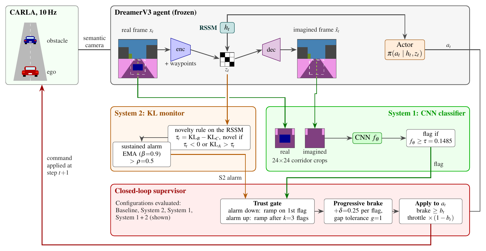
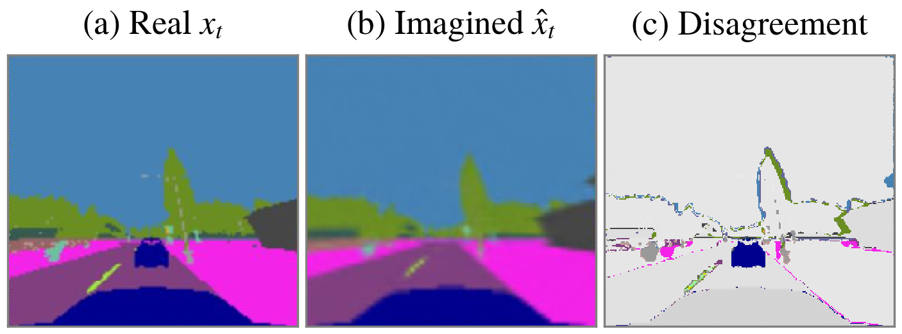

<div align="center">

# Anomaly Detection in Autonomous Driving Agents Using World Models

**A two-tier Anomaly Observation System for DreamerV3 driving agents in CARLA**

Konstantinos Oikonomou · Pavlos-Apostolos Tosidis · Anastasios Tefas<br>
Department of Informatics, Aristotle University of Thessaloniki


[Paper](pappers/Anomaly%20Detection%20in%20Autonomous%20Driving%20Agents%20Using%20World%20Models.pdf) · [Thesis](pappers/Anomaly%20Detection%20in%20Autonomous%20Driving%20Agents%20Using%20World%20Models%20Thesis%20Greek.pdf) · [Installation](#installation) · [Quick start](#quick-start) · [Reproducing the paper](#reproducing-the-paper) · [Citation](#citation)

</div>

---

## Overview

End-to-end reinforcement learning drivers optimize perception and planning jointly, which leaves no natural place to insert an independent safety check. This repository adds one to a **world-model-based** agent, using the agent's own world model as the reference for what the scene *should* look like.

A DreamerV3 agent learns to follow waypoints in CARLA from a roof-mounted **semantic camera** and a vehicle-frame waypoint vector. On top of the frozen agent, two complementary detectors run at every control step:

| | **System 1: CNN classifier** | **System 2: KL monitor** |
|---|---|---|
| Signal | Local, spatial | Global, distributional |
| Input | Real vs. imagined (decoder-reconstructed) semantic frame, 24×24 corridor crop | Prior and posterior distributions of the RSSM |
| Question answered | *Is there an obstacle in my path?* | *Does my world model still fit this environment?* |
| Best regime | Well-fitted world model | Abrupt scene change (new town) |

The System 1 / System 2 naming is a functional analogy to dual-process theory: a fast local detector and a slower, temporally aggregated monitor of world-model validity.

A **closed-loop supervisor** turns persistent System 1 detections into a progressive brake, while a sustained System 2 alarm lowers the trust placed in System 1 by delaying the brake ramp.

<p align="center">
  
</p>

<p align="center">
  <br>
  <sub>The decoder reconstructs the scene the world model expects. An obstacle on the route appears in the real frame (a) but not in the imagined one (b); (c) shows the pixels whose semantic class differs.</sub>
</p>

## Highlights

- **Collision avoidance.** With a single parked vehicle on the route, the unsupervised agent collides in 98, 84 and 75 of 100 episodes (static route, random route, random towns). With the supervisor (System 1 or System 1 + 2) no collision occurs in any of the three scenarios. On the static route the car stops at a median of 18 m from the obstacle.
- **Learned detection beats a plain disagreement count.** On the held-out test episodes the CNN reaches recall 0.940 at a false-positive rate of 0.042 (MCC 0.796). Thresholding the fraction of disagreeing pixels in the same crop, with the same threshold rule, gives MCC 0.369 at a false-positive rate of 0.318.
- **Complementary operating regimes.** The KL monitor is nearly silent under a well-fitted world model (false-positive rate 0.009) and fires on most frames in unfamiliar towns, where System 1 loses precision. This is the information the trust gate uses.
- **Real time.** The full monitoring pipeline (actor, world model with KL rule and reconstruction, CNN, supervisor) takes 33 ms per step on average on an RTX 3080, against a 100 ms control period at 10 Hz.

## Repository structure

```
.
├── code/          the code overlay for SheepRL (see below)
├── docs/          INSTALL.md, MANUAL.md, requirements.txt and the README figures
├── results/       the evaluation result files behind the paper's tables
├── pappers/       the paper and the diploma thesis (PDF)
└── README.md
```

| Document | Contents |
|---|---|
| [Paper](pappers/Anomaly%20Detection%20in%20Autonomous%20Driving%20Agents%20Using%20World%20Models.pdf) | *Anomaly Detection in Autonomous Driving Agents Using World Models* |
| [Thesis](pappers/Anomaly%20Detection%20in%20Autonomous%20Driving%20Agents%20Using%20World%20Models%20Thesis%20Greek.pdf) | Diploma thesis, Aristotle University of Thessaloniki (in Greek) |
| [docs/INSTALL.md](docs/INSTALL.md) | Full installation and reproduction guide |
| [docs/MANUAL.md](docs/MANUAL.md) | Every configuration variable, the run matrix and the output format |

The code is an **overlay** on top of SheepRL: install CARLA and SheepRL from their upstream sources, then copy these files into the SheepRL checkout. `dreamer_v3.py` and the rest of SheepRL are used unmodified.

```
code/
├── PythonAPI/                       vendored CARLA agents/navigation code and route planner
│                                    (placed at the repository root, next to sheeprl.py)
└── sheeprl/
    ├── cli.py                       modified CLI entry
    ├── utils/env.py                 environment factory, registers `carla_env_dream`
    ├── envs/carla_env_dream.py      Gymnasium CARLA environment (scenario, obstacle regime)
    ├── algos/dreamer_v3/
    │   ├── agent.py                 DreamerV3 player with the KL novelty rule (get_states)
    │   ├── utils.py                 detectors, labelling operators, safety supervisor,
    │   │                            evaluation loop and metrics
    │   ├── cnn_classifier.py        System 1 CNN classifier (Keras)
    │   └── train_classifier.py      classifier training, threshold selection,
    │                                non-learned mismatch baseline
    └── configs/
        ├── algo/dreamer_v3.yaml
        ├── env/carla_env_dream.yaml
        └── exp/dreamer_v3.yaml      experiment hyperparameters
```

## Installation

### Requirements

| | Used in our runs |
|---|---|
| OS | Ubuntu Linux (20.04 / 22.04), x86-64 |
| GPU | NVIDIA GPU with a CUDA 12 driver (CARLA and DreamerV3 share it) |
| Python | **3.8.10** (the pinned package set requires 3.8) |
| Disk | about 25 GB (CARLA package, virtual environment, logs and checkpoints) |
| RAM | 32 GB recommended |

### 1. CARLA 0.9.15

Download the prebuilt **CARLA 0.9.15** Linux package from the [official releases](https://github.com/carla-simulator/carla/releases), extract it (e.g. to `/opt/carla-simulator`) and start the server in its own terminal:

```bash
/opt/carla-simulator/CarlaUE4.sh -RenderOffScreen -nosound -carla-server
```

The Python client is the pip package `carla==0.9.15`, installed in the next step. Client and server versions must match.

### 2. This repository and the Python environment

```bash
python3.8 -m venv ~/venvs/aos
source ~/venvs/aos/bin/activate
pip install --upgrade pip

git clone https://github.com/kostasoiko4/Anomaly-Detection-in-Autonomous-Driving-Agents-Using-World-Models.git
pip install -r Anomaly-Detection-in-Autonomous-Driving-Agents-Using-World-Models/docs/requirements.txt
```

PyTorch (DreamerV3) and TensorFlow (the CNN classifier) live in the same environment; the pinned versions in `docs/requirements.txt` are a combination known to work.

### 3. SheepRL and the overlay

From the same parent folder:

```bash
git clone https://github.com/Eclectic-Sheep/sheeprl.git
cd sheeprl
pip install -e . --no-deps

# copy the overlay into the SheepRL checkout
cp -r ../Anomaly-Detection-in-Autonomous-Driving-Agents-Using-World-Models/code/PythonAPI .
cp -r ../Anomaly-Detection-in-Autonomous-Driving-Agents-Using-World-Models/code/sheeprl   .
```

All commands below run **from the root of the SheepRL checkout**, inside the virtual environment, with the CARLA server running. See [docs/INSTALL.md](docs/INSTALL.md) for the full guide and troubleshooting.

## Quick start

A short evaluation on the static route with a single parked car, using an S1 agent trained as in [Step 1](#step-1-train-the-agents) and a classifier trained as in [Step 3](#step-3-train-the-classifier):

1. In `sheeprl/envs/carla_env_dream.py` set `ROUTE_SCENARIO = "static"` and `OBSTACLE_REGIME = "single"`.
2. In `sheeprl/algos/dreamer_v3/utils.py` set `OBSTACLE_REGIME = "single"`, `SAFETY_MODE = "baseline"` and `TEST_EPISODES = 3`.
3. Run:

```bash
python3 sheeprl_eval.py +env=carla_env_dream \
    checkpoint_path="<your S1 checkpoint>.ckpt" \
    fabric.accelerator=cuda env.capture_video=False
```

In `baseline` mode the detectors run and are logged but never act, so most episodes end in a collision with the parked car. Set `SAFETY_MODE = "s1"` or `"both"` and run again: the episodes now end in safe stops before the obstacle.

## How it works

**World model and agent.** DreamerV3 (SheepRL, PyTorch) observes a 64×64 semantic camera frame and the next five route waypoints in the vehicle frame, and drives with a discrete grid of 3 accelerations × 5 steering values at 10 Hz.

**System 1.** Both the real frame and the decoder's reconstruction are mapped to semantic class indices (nearest CityScapes palette colour) and cropped to a fixed 24×24 window over the drivable corridor. A compact CNN classifies the pair; a frame is flagged when its sigmoid output reaches τ = 0.1485, the largest threshold that keeps validation recall at or above 0.81.

**System 2.** Following Zollicoffer et al. (ICML 2025), three KL divergences are computed from the RSSM at every step, all with the full posterior as base distribution: against the prior at the current history (KL<sub>A</sub>), against the prior at an empty history (KL<sub>B</sub>) and against the posterior at an empty history (KL<sub>C</sub>). With τ<sub>t</sub> = KL<sub>B</sub> − KL<sub>C</sub>, a frame is novel if τ<sub>t</sub> < 0 or KL<sub>A</sub> > τ<sub>t</sub>. An exponential moving average (β = 0.9) above ρ = 0.5 raises a sustained alarm.

**Supervisor.** Each consecutive System 1 flag raises the brake by δ = 0.25, so the fourth consecutive flag commands a full stop; a gap of one frame is tolerated. While the System 2 alarm is up, the ramp starts only after k = 3 consecutive flags. The brake is applied to the actor's command at the next step (brake at least b<sub>t</sub>, throttle scaled by 1 − b<sub>t</sub>).

## Reproducing the paper

### Configuration

Experiments are selected through global variables at the top of the files; [docs/MANUAL.md](docs/MANUAL.md) documents every one of them.

| File | Variable | Values |
|---|---|---|
| `envs/carla_env_dream.py` | `ROUTE_SCENARIO` | `"static"` (S1), `"random"` (S2), `"random_towns"` (S3) |
| `envs/carla_env_dream.py` | `OBSTACLE_REGIME` | `"none"` (training), `"single"` (R1), `"random"` (R2) |
| `algos/dreamer_v3/utils.py` | `OBSTACLE_REGIME` | must match the environment |
| `algos/dreamer_v3/utils.py` | `SAFETY_MODE` | `"baseline"`, `"s1"`, `"s2"`, `"both"` |
| `algos/dreamer_v3/utils.py` | `TEST_EPISODES`, `BUILD_DATASET`, `CLASSIFIER_PATH`, `CLASSIFIER_THRESHOLD` | evaluation settings |
| `algos/dreamer_v3/train_classifier.py` | `TRAIN_CLASSIFIER`, `THRESHOLD_ANALYSIS`, `MISMATCH_BASELINE` | classifier workflow |

> **Consistency rule:** `OBSTACLE_REGIME` decides what is spawned (environment) and which labelling operator is used (`utils.py`). It must hold the same value in both files.

### Step 1: train the agents

One run per driving scenario, with `OBSTACLE_REGIME = "none"` and the matching `ROUTE_SCENARIO`:

```bash
python3 sheeprl.py exp=dreamer_v3 env=carla_env_dream fabric.accelerator=cuda checkpoint.every=1000
```

The paper evaluates the checkpoints at 131k (S1), 246k (S2) and 535k (S3) environment steps. Trained models are not included in this repository because of their size. Training can be resumed with `checkpoint.resume_from="<path to ckpt>"`.

### Step 2: collect the classifier dataset

With the random-route agent: `ROUTE_SCENARIO = "random"`, `OBSTACLE_REGIME = "random"` in both files, `SAFETY_MODE = "baseline"` and `BUILD_DATASET = True`, then run an evaluation pass:

```bash
python3 sheeprl_eval.py +env=carla_env_dream checkpoint_path="<S2 checkpoint>" \
    fabric.accelerator=cuda env.capture_video=False
```

Each frame pair is stored as `random_distribution_dataset/{normal,anomaly}/{camera,imagination}/{episode}_{timestep}.npy`, labelled automatically by the class-agnostic operator, so no frame is labelled by hand.

### Step 3: train the classifier

```bash
python3 ./sheeprl/algos/dreamer_v3/train_classifier.py
```

The dataset is split by whole episodes (70 / 15 / 15 % of the frames), so no test frame shares an episode with a training frame. With `TRAIN_CLASSIFIER = True` the network is trained and saved; `THRESHOLD_ANALYSIS = True` selects τ on the validation split and scores the test split once; `MISMATCH_BASELINE = True` evaluates the non-learned pixel-mismatch baselines with the same split and threshold rule. Copy the selected τ into `CLASSIFIER_THRESHOLD` in `utils.py`.

### Step 4: evaluation

For each of the six conditions (regimes R1, R2 × scenarios S1, S2, S3), run the evaluation command with the matching scenario checkpoint once per supervisor configuration, 100 episodes each:

| `SAFETY_MODE` | Role |
|---|---|
| `"baseline"` | open-loop agent: detection metrics, and the reference for the safety evaluation |
| `"s2"` | System 2 alone acts on the vehicle |
| `"s1"` | System 1 alone acts on the vehicle |
| `"both"` | the two-tier Anomaly Observation System |

Episodes are drawn independently in every run (routes, obstacle types and placements), so configurations are compared through the 95 % Wilson intervals of their rates; expect results to match within those intervals rather than digit for digit.

### Outputs and the included results

The `results/` folder holds the result files of the evaluation runs reported in the paper, so the tables can be checked without running CARLA. Every run writes a JSON file with:

- `summary`: outcome rates (collision, safe stop, lane departure, route completion, waypoint loss, timeout), stopping margin, brake onset, impact speed, early braking, alarm share, the detection metrics of both detectors against the label, and `config` with every setting of the run;
- `episodes`: one record per episode with its outcome and, per frame, a trace of speed, obstacle distance, label, System 1 and System 2 decisions, alarm and brake.

## Scope

The results hold under the conditions of the study: static obstacles; a fixed 24×24 corridor window, which resolves vehicle-sized obstacles better than small props; one training run per scenario; and 100 evaluation episodes per configuration. The random-towns world model does not converge in reconstruction and is read as a stress test. See the paper for the full discussion.

## Citation

If you use this work, please cite the [paper](pappers/Anomaly%20Detection%20in%20Autonomous%20Driving%20Agents%20Using%20World%20Models.pdf):

```bibtex
@misc{oikonomou2026anomaly,
  title  = {Anomaly Detection in Autonomous Driving Agents Using World Models},
  author = {Oikonomou, Konstantinos and Tosidis, Pavlos-Apostolos and Tefas, Anastasios},
  year   = {2026},
  note   = {Department of Informatics, Aristotle University of Thessaloniki},
  url    = {https://github.com/kostasoiko4/Anomaly-Detection-in-Autonomous-Driving-Agents-Using-World-Models}
}
```

## Acknowledgements

This work builds on [CARLA](https://carla.org/), [SheepRL](https://github.com/Eclectic-Sheep/sheeprl) and [DreamerV3](https://danijar.com/project/dreamerv3/) (Hafner et al.). The System 2 rule follows *Novelty Detection in Reinforcement Learning with World Models* (Zollicoffer et al., ICML 2025), design choices for the driving environment were informed by [CarDreamer](https://github.com/ucd-dare/CarDreamer) (Gao et al., 2024), included in `PythonAPI/` is the edited CARLA agents/navigation code.
